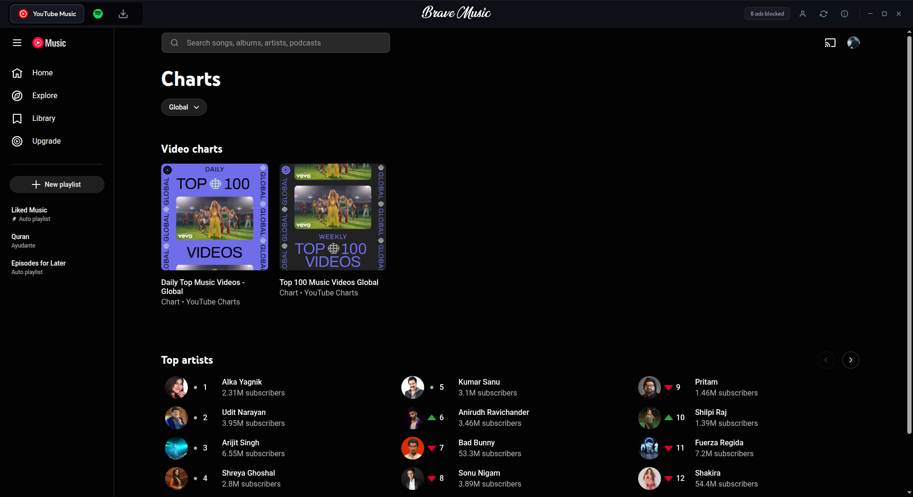
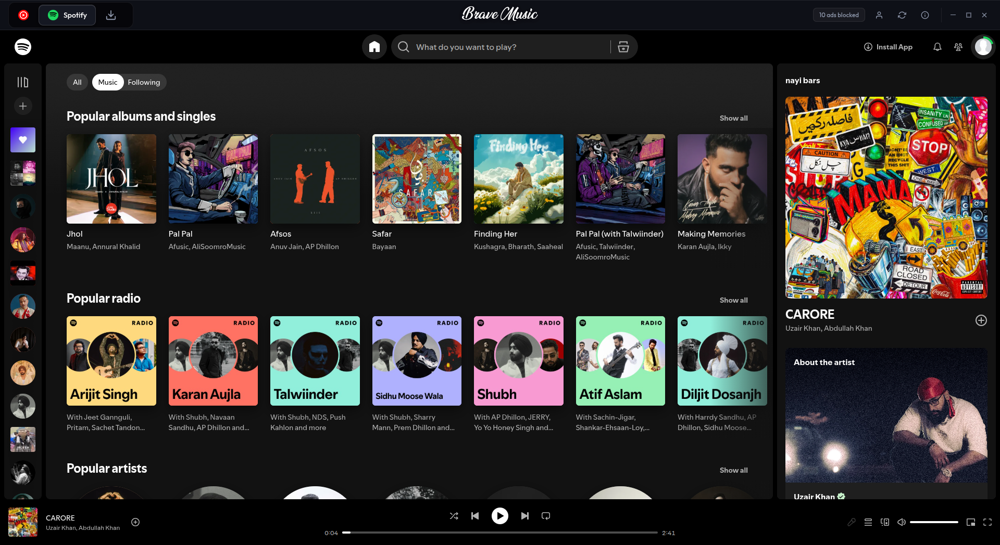
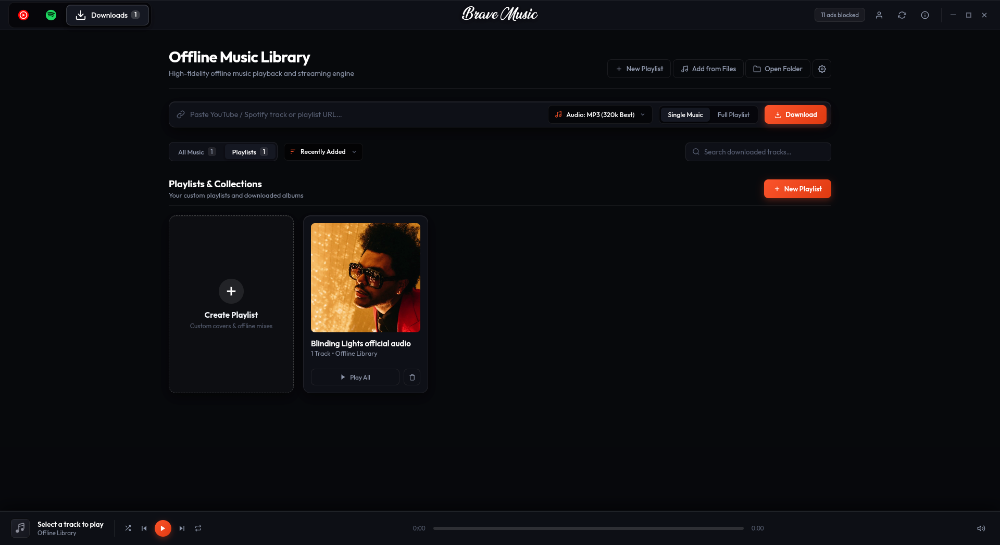

<div align="center">


# Brave Music

### Your Music. Your Privacy. Your Control.

**An open-source music streaming and offline playback platform.**

Brave Music combines YouTube Music, Spotify Web, and an embedded native C++ audio engine into one unified desktop experience. Engineered around privacy, performance, DRM-compatible playback, and offline music management.

<br/>

<table border="0" align="center">
<tr>
<td align="center">
<a href="https://github.com/codemoteams/Brave-Music/releases/download/v1.0.3/brave-music_1.0.3_amd64.deb"></a><br/>
<sub><strong>Linux</strong></sub>
</td>
<td width="28"></td>
<td align="center">
<a href="#platform-availability"></a><br/>
<sub><strong>Windows</strong></sub>
</td>
<td width="28"></td>
<td align="center">
<a href="#platform-availability"></a><br/>
<sub><strong>Android</strong></sub>
</td>
</tr>
</table>

<br/>

<table align="center" border="0">
<tr>
<td align="center"><strong>120 MB</strong><br/><sub>Package Size</sub></td>
<td width="20"></td>
<td align="center"><strong>C++</strong><br/><sub>Audio Engine</sub></td>
<td width="20"></td>
<td align="center"><strong>GPL-3.0</strong><br/><sub>License</sub></td>
<td width="20"></td>
<td align="center"><strong>v1.0.3</strong><br/><sub>Release</sub></td>
</tr>
</table>

<br/>

<a href="https://github.com/codemoteams/Brave-Music/releases/download/v1.0.3/brave-music_1.0.3_amd64.deb"></a><a href="#developer-portal"></a><a href="docs/RELEASE.md"></a><a href="docs/CONTRIBUTION.md"></a>

</div>

---

## Product Overview

Brave Music is an integrated desktop music environment that combines web-based streaming services with native offline audio capabilities.

Built using privacy-focused browser technology and an embedded Musikcube audio engine, it provides a unified interface for streaming, downloading, organizing, and playing music.

### Core Capabilities

| Feature | Description |
|:---|:---|
| **YouTube Music** | Integrated YouTube Music streaming experience. |
| **Spotify Web** | Embedded Spotify Web Player with supported Widevine DRM playback. |
| **Native Audio Engine** | Embedded C++ Musikcube audio playback engine. |
| **Offline Music** | Local music management and offline playback. |
| **Music Downloads** | Integrated download functionality using yt-dlp. |
| **Privacy Protection** | Brave Shields integration and reduced third-party tracking. |
| **Desktop Experience** | Unified desktop application with a native Linux installation package. |

---

## Product Experience

Explore the Brave Music interface and its primary application components.

<div align="center">

### YouTube Music Integration

<a href="testimonials/yt-music.png">

</a>

<sub>Integrated music discovery and streaming experience.</sub>

<br/><br/>

### Spotify Web Integration

<a href="testimonials/spotify.png">

</a>

<sub>Embedded Spotify Web Player with supported DRM playback.</sub>

<br/><br/>

### Offline Downloads and Native Engine

<a href="testimonials/downloads.png">

</a>

<sub>Offline music downloads and native playback management.</sub>

</div>

---

## Installation

<a id="platform-availability"></a>

### Linux Desktop

<sub>AVAILABLE NOW · VERSION 1.0.3 · X86_64</sub>

Brave Music currently provides a standalone Debian installation package for compatible Linux distributions.

**Supported distributions:**

- Ubuntu
- Debian
- Linux Mint
- Pop!_OS

### Install Using APT

```bash
# 1. Download official v1.0.3 Debian package
wget https://github.com/codemoteams/Brave-Music/releases/download/v1.0.3/brave-music_1.0.3_amd64.deb

# 2. Install package via APT
sudo apt install ./brave-music_1.0.3_amd64.deb

# 3. Launch from desktop application menu or terminal
brave-music
```

Direct binary download: [**brave-music_1.0.3_amd64.deb (120 MB)**](https://github.com/codemoteams/Brave-Music/releases/download/v1.0.3/brave-music_1.0.3_amd64.deb)

For complete installation steps, building from source, dependency management, and uninstallation, see [**docs/INSTALL.md**](docs/INSTALL.md).

### Installation Resources

| Resource | Description |
|:---|:---|
| [Installation Guide](docs/INSTALL.md) | Complete installation and configuration instructions. |
| [Developer Guide](docs/DEV-GUIDE.md) | Build the application from source. |
| [Release Notes](docs/RELEASE.md) | Review available versions and release information. |

---

## Technical Specifications

| Component | Technology |
|:---|:---|
| Application | Brave Music Desktop |
| Embedded Browser | CastLabs Chromium Runtime |
| DRM Technology | Widevine |
| Native Audio Engine | Musikcube (C++) |
| Download Integration | yt-dlp |
| Browser Protection | Brave Shields |
| Distribution Format | Debian Package |
| Supported Architecture | Linux x64 |
| Software License | GPL-3.0 |

### Privacy and Protection

Brave Music integrates Brave Shields to help reduce intrusive advertisements, unwanted trackers, and third-party tracking within supported browsing contexts.

<div align="center">


<sub>Brave Shields protection demonstration.</sub>

</div>

---

## Developer Portal

**Everything developers need to understand, build, secure, and contribute to Brave Music.**

The developer portal provides technical documentation, architecture references, design standards, contribution guidelines, and organizational policies.

### Documentation Directory

| Documentation | Scope | Description |
|:---|:---|:---|
| [INSTALL.md](docs/INSTALL.md) | Installation | System requirements, dependencies, installation, and setup. |
| [DEV-GUIDE.md](docs/DEV-GUIDE.md) | Engineering | Application architecture, Mermaid diagrams, DRM integration, and build pipeline. |
| [DESIGN-GUIDE.md](docs/DESIGN-GUIDE.md) | UI / UX | Interface specifications, design tokens, typography, and visual standards. |
| [CONTRIBUTION.md](docs/CONTRIBUTION.md) | Development | Contribution requirements, pull requests, Android milestone, and community participation. |
| [RELEASE.md](docs/RELEASE.md) | Releases | Version history, changelogs, SHA-256 checksums, and roadmap. |
| [SECURITY.md](docs/SECURITY.md) | Security | Vulnerability reporting and security boundaries. |
| [RULES.md](docs/RULES.md) | Governance | Product ownership, organizational authority, and developer policies. |
| [CREDITS.md](docs/CREDITS.md) | Acknowledgments | Third-party technologies, upstream projects, and contributors. |

### Developer Resources

- **Architecture:** Review the application architecture and embedded component integration.
- **Build Environment:** Follow the official build and dependency instructions.
- **Interface Standards:** Follow the established UI/UX design specifications.
- **Security:** Review the security policy before reporting or investigating vulnerabilities.
- **Contributions:** Follow the official contribution guidelines before submitting changes.

---

## Organization

<div align="center">


### Codemo Open Source Labs

**Engineering · Innovation · Open Source**

</div>

Brave Music is an official open-source software project created and governed by **Codemo Open Source Labs (Codemo OSL)**.

Codemo OSL develops open-source software solutions, promotes technical education, and provides a collaborative environment for developers to advance their engineering capabilities through practical projects, technical documentation, and community participation.

### Official Community

| Channel | Information |
|:---|:---|
| **Official Website** | [codemoteams.org](https://codemoteams.org) |
| **Developer Community** | Codemo Teams Discord Server |
| **Project Collaboration** | Official GitHub repositories |
| **Contributor Recognition** | Subject to organizational participation requirements |

Developers interested in contributing should review the official contribution documentation and organizational participation policies.

---

## Governance and Legal Information

| Property | Information |
|:---|:---|
| Product Name | Brave Music |
| Current Version | `v1.0.3` |
| Product Organization | Codemo Open Source Labs |
| Product Authority | Codemo OSL |
| Software License | GPL-3.0 |
| Documentation Directory | `docs/` |

### Ownership and Intellectual Property

Brave Music is an official software product created and governed by Codemo Open Source Labs.

Codemo OSL retains its applicable organizational rights, product branding, and governance authority over official Brave Music releases and affiliated distribution channels.

The software codebase is distributed under the terms of the [GNU General Public License v3.0](LICENSE).

For complete organizational policies, ownership information, and developer requirements, refer to [docs/RULES.md](docs/RULES.md).
