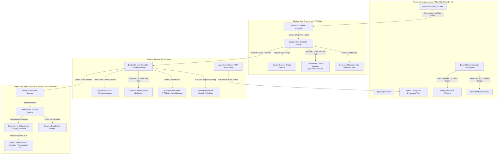

<div align="center">

  <table border="0" style="border-collapse: collapse; border: none;" align="center">
    <tr style="border: none;">
      <td align="center" style="border: none;">
        
      </td>
    </tr>
  </table>

  # Brave Music
  
  <p style="font-size: 16px; color: #8e97ab; margin-top: 4px; margin-bottom: 12px;">
    A high-performance open-source music streaming platform combining ad-free YouTube Music and Spotify Web with an embedded C++ offline playback engine.<br />
    Engineered for privacy, native Widevine DRM playback, and offline listening.
  </p>

  <p>
    <strong>Codemo Open Source Labs</strong> &nbsp;•&nbsp; 
    <span>Music and Audio</span> &nbsp;•&nbsp; 
    <span>Free and Open Source</span> &nbsp;•&nbsp; 
    <span>v1.0.0 Stable</span>
  </p>

  <!-- COSL Native Color Theme Platform Badges -->
  <p>
    <a href="#install-portal">
      
    </a>
    <a href="#install-portal">
      
    </a>
    <a href="#install-portal">
      
    </a>
    <a href="#install-portal">
      
    </a>
  </p>

  <!-- Metrics Bar -->
  <table align="center" style="margin-top: 12px; margin-bottom: 20px;">
    <tr>
      <td align="center" width="130">
        <strong>4.9 ★</strong><br />
        <span style="font-size: 11px; color: #7f8699;">Community Rating</span>
      </td>
      <td align="center" width="130">
        <strong>119 MB</strong><br />
        <span style="font-size: 11px; color: #7f8699;">Debian Package</span>
      </td>
      <td align="center" width="130">
        <strong>Zero Trackers</strong><br />
        <span style="font-size: 11px; color: #7f8699;">Brave Shields</span>
      </td>
      <td align="center" width="130">
        <strong>C++ Engine</strong><br />
        <span style="font-size: 11px; color: #7f8699;">Embedded Musikcube</span>
      </td>
      <td align="center" width="130">
        <strong>MIT License</strong><br />
        <span style="font-size: 11px; color: #7f8699;">Codemo OSL</span>
      </td>
    </tr>
  </table>

  <!-- Portal Action Links -->
  <p>
    <a href="#install-portal"><strong>[ 📥 Install App (Linux .deb) ]</strong></a>
    &nbsp;&nbsp;&nbsp;&nbsp;
    <a href="#developer-portal"><strong>[ 💻 Developer Portal ]</strong></a>
    &nbsp;&nbsp;&nbsp;&nbsp;
    <a href="#architecture-specs"><strong>[ 🏛️ Architecture Specs ]</strong></a>
    &nbsp;&nbsp;&nbsp;&nbsp;
    <a href="docs/CONTRIBUTION.md"><strong>[ 🤝 Contribute ]</strong></a>
  </p>

</div>

---

## App Screenshots and Interface

<table width="100%">
  <tr>
    <th width="33%" align="center">YouTube Music Streaming</th>
    <th width="33%" align="center">Spotify Web Player</th>
    <th width="33%" align="center">Offline Downloads and Engine</th>
  </tr>
  <tr>
    <td>
      <a href="testimonials/yt-music.png">
        
      </a>
    </td>
    <td>
      <a href="testimonials/spotify.png">
        
      </a>
    </td>
    <td>
      <a href="testimonials/downloads.png">
        
      </a>
    </td>
  </tr>
  <tr>
    <td align="center"><small>Ad-free streaming with persistent session caching</small></td>
    <td align="center"><small>Widevine DRM-enabled Web Playback API</small></td>
    <td align="center"><small>Embedded 320kbps offline downloader via yt-dlp</small></td>
  </tr>
</table>

### Brave Shields Protection in Action

<div align="center" style="margin-top: 18px; margin-bottom: 24px;">
  
  <p style="color: #8e97ab; font-size: 13px; margin-top: 8px;">
    Real-time Brave Shields network request blocking and cosmetic filter injection running silently during media playback.
  </p>
</div>

---

## Install Portal

### Standalone Debian Package (Linux x64)

Download and install the verified Debian package on Ubuntu, Debian, Linux Mint, or Pop!_OS:

```bash
# 1. Install package via APT
sudo apt install ./brave-music_1.0.0_amd64.deb

# 2. Launch from desktop application menu or terminal
brave-music
```

For complete installation steps, building from source, dependency management, and uninstallation, see [**docs/INSTALL.md**](docs/INSTALL.md).

### Supported Operating Systems Matrix

| Platform | Availability Status | Distribution Type | Details |
| :--- | :--- | :--- | :--- |
| **Linux (x64)** | **Available Now (v1.0.0)** | Debian Package (`.deb`) and Source Run | Full hardware acceleration, Widevine DRM, embedded audio daemon |
| **Android** | **Next Roadmap Milestone** | Native Android APK | Mobile port planned with background audio service and touch navigation |
| **Windows** | Coming Soon | Portable EXE and MSI Installer | Port in progress using Windows CastLabs runtime |
| **macOS** | Coming Soon | DMG Package | Universal binary for Apple Silicon and Intel |

---

## Developer Portal

Brave Music is an open-source collaboration maintained under Codemo Open Source Labs. Review the modular guides in the `docs/` directory before building or submitting code:

| Documentation | Primary Scope | Read When You Need To |
| :--- | :--- | :--- |
| [**docs/INSTALL.md**](docs/INSTALL.md) | Installation and Setup Guide | Install via deb package, compile from source, and configure system dependencies |
| [**docs/RULES.md**](docs/RULES.md) | Legal Ownership and Governance | Understand Codemo OSL product ownership, legal rights, and developer rules |
| [**docs/CONTRIBUTION.md**](docs/CONTRIBUTION.md) | Contributor Workflow and Android Milestone | Learn the PR submission process, Android development goals, and Discord perks |
| [**docs/DEV-GUIDE.md**](docs/DEV-GUIDE.md) | Local Setup and Architecture Specs | Complete project architecture, Mermaid diagrams, DRM checks, and build pipeline |
| [**docs/DESIGN-GUIDE.md**](docs/DESIGN-GUIDE.md) | UI/UX Specs and Design Tokens | Follow the dark color palette, Ananda Black typography, and mobile touch targets |
| [**docs/CREDITS.md**](docs/CREDITS.md) | Upstream Technologies and Authors | View acknowledgments for CastLabs, Musikcube, Brave, yt-dlp, and community devs |
| [**docs/SECURITY.md**](docs/SECURITY.md) | Security Policy and Disclosure | Report vulnerabilities responsibly and inspect IPC sandbox isolation boundaries |

---

## Architecture Specs

Brave Music organizes its runtime into three synchronized tiers:



<div align="center">
  <p>
    <a href="#architecture-specs"><strong>[ 🔍 Fit View / Reset ]</strong></a> &nbsp;&nbsp;|&nbsp;&nbsp;
    <a href="https://mermaid.live" target="_blank" rel="noopener noreferrer"><strong>[ ↗ Open Interactive Mermaid Live Editor ]</strong></a>
  </p>
</div>

<details>
<summary><strong>Click to View Raw Architecture Diagram Source Code</strong></summary>

```text
graph TD
    subgraph UI ["Frontend Interface Layer (HTML5 / CSS / Vanilla JS)"]
        A[Brave Music Desktop Shell]
        A1[Top Navigation Bar]
        A2[YouTube Music Webview]
        A3[Spotify Web Player Webview]
        A4[Offline Library and Downloads View]
        A5[Brave Shields Cosmetic Filter Engine]
    end

    subgraph IPC ["Electron Core Process and IPC Bridge"]
        B[Electron Main Controller - main.js]
        B1[Preload IPC Bridge - preload.js]
        B2[CastLabs Chromium with Widevine CDM]
        B3[Session and Cookie Manager persist:bravemusic]
        B4[System Browser OAuth Fallback]
    end

    subgraph Backend ["Node.js Backend Service Layer"]
        C[Backend Server Controller - backend/index.js]
        C1[AdBlockService and BraveShieldsRules]
        C2[AuthSyncService and YTMDevtoolsAuthService]
        C3[DownloadService with yt-dlp Worker]
        C4[LibraryService and Metadata Indexer]
        C5[Local StreamServer HTTP Audio Proxy]
    end

    subgraph Engine ["Native C++ Audio Engine (backend/engine/musikcube)"]
        D[musikcubed Native Daemon]
        D1[libmusikcore.so Core Pipeline]
        D2[libtag.so.2 Audio Tag Reader]
        D3[libavcodec and libavformat FFmpeg Decoders]
        D4[Audio Output Drivers - PipeWire / PulseAudio / ALSA]
    end

    A --> B1
    B1 --> B
    B --> B2
    B --> B3
    B --> B4
    B --> C
    A5 --> A2
    A5 --> A3
    C --> C1
    C --> C2
    C --> C3
    C --> C4
    C --> D
    C5 --> A4
    D --> D1
    D1 --> D2
    D1 --> D3
    D3 --> D4
```
</details>

---

## Organization and Governance

<div align="center">
  
  <h3>Codemo Open Source Labs (Codemo OSL)</h3>
</div>

**Mission and Purpose**:
Codemo Open Source Labs builds united solutions, creativity, and technical education on a single platform. COSL helps developers learn Open Source software engineering and advance to PRO Developer capabilities by following official guides and contributing directly to official community projects.

### Community Channels and Contributor Perks
- **Official Platform**: Visit [codemoteams.org](https://codemoteams.org) to register your developer account.
- **Discord Community**: Join the **Codemo Teams Discord Server** to participate in architectural discussions, track milestones, and receive active contributor benefits.
- **Perk Eligibility**: To qualify for official contributor perks, rewards, and recognitions, developers must hold an active account on `codemoteams.org` and maintain regular participation in the Codemo Teams Discord.

---

## Legal Authority and Ownership Notice

- **App Version**: `v1.0.0`
- **Product Authority**: Brave Music is an official open-source product created and governed by **Codemo Open Source Labs**.
- **Intellectual Property**: Codemo OSL retains exclusive organizational ownership, trademark rights, and distribution governance over the Brave Music product name, official releases, and affiliated packages.
- **License**: The codebase is distributed under the terms of the [MIT License](LICENSE). Refer to [docs/RULES.md](docs/RULES.md) for complete organizational policies and contributor agreements.