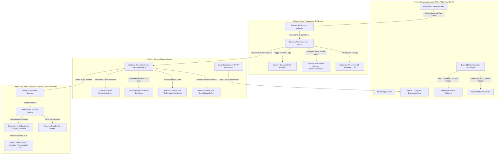

<div align="center">

  

  # Brave Music

  <p>
    <strong>A high-performance open-source music streaming platform combining ad-free YouTube Music and Spotify Web with an embedded C++ offline playback engine.</strong><br />
    <strong>Engineered for privacy, native Widevine DRM playback, and offline listening.</strong>
  </p>

  <p>
    <a href="#supported-platforms">
      
    </a>
    <a href="#supported-platforms">
      
    </a>
    <a href="#supported-platforms">
      
    </a>
    <a href="#supported-platforms">
      
    </a>
    <a href="#supported-platforms">
      
    </a>
  </p>

  <p>
    
    
    
    
  </p>

</div>

---

## Showcase and Demonstration

### Brave Shields Ad-Blocking in Action

<div align="center">
  
  <p><em>Real-time Brave Shields network filtering and cosmetic ad blocking during media playback</em></p>
</div>

### Product Screenshots

<table width="100%">
  <tr>
    <th width="33%">YouTube Music Web Player</th>
    <th width="33%">Spotify Web Player</th>
    <th width="33%">Offline Library and Downloads</th>
  </tr>
  <tr>
    <td>
      <a href="testimonials/yt-music.png">
        
      </a>
    </td>
    <td>
      <a href="testimonials/spotify.png">
        
      </a>
    </td>
    <td>
      <a href="testimonials/downloads.png">
        
      </a>
    </td>
  </tr>
  <tr>
    <td align="center">Ad-free streaming with persistent session caching</td>
    <td align="center">Widevine DRM-enabled Web Playback API</td>
    <td align="center">Embedded 320kbps offline downloader via yt-dlp</td>
  </tr>
</table>

---

## Supported Operating Systems

| Operating System | Support Status | Distribution Format | Architecture |
| :--- | :--- | :--- | :--- |
| **Linux** | **Available Now** | Standalone Debian Package (`.deb`) and source build | `amd64` |
| **Android** | **Next Roadmap Target** | Native APK and Background Service | `arm64-v8a`, `armeabi-v7a` |
| **Windows** | Coming Soon | MSI / NSIS Installer | `x64` |
| **macOS** | Coming Soon | DMG / Universal Binary | `Apple Silicon`, `Intel` |
| **iOS** | Coming Soon | IPA / TestFlight | `arm64` |

---

## Project Documentation

Review the dedicated documentation guides before developing, designing, or contributing:

| Document | Purpose | Target Audience | Primary Focus |
| :--- | :--- | :--- | :--- |
| [**RULES.md**](RULES.md) | Legal ownership, governance, non-negotiable rules | All Developers, Forkers | Product ownership rights, compliance standards, behavioral conduct |
| [**CONTRIBUTION.md**](CONTRIBUTION.md) | Contribution guide, Android roadmap, contributor perks | Contributors, Maintainers | Android target milestone, PR workflow, Discord perk requirements |
| [**DEV-GUIDE.md**](DEV-GUIDE.md) | Technical setup, architecture, and build scripts | Core Developers, Packagers | Environment setup, CastLabs DRM checks, Musikcube engine, Debian build |
| [**DESIGN-GUIDE.md**](DESIGN-GUIDE.md) | Visual language, design tokens, component rules | UI/UX Designers, Developers | Dark palette, Ananda Black typography, webview shields, mobile layouts |
| [**CREDITS.md**](CREDITS.md) | Acknowledgments of upstream tools and authors | Public, Community | CastLabs, Musikcube, Brave Software, yt-dlp, and community credits |
| [**SECURITY.md**](SECURITY.md) | Vulnerability disclosure and security posture | Security Researchers, Devs | Disclosure email, IPC isolation boundaries, DRM integrity, audit policy |

---

## Project Architecture

The following diagram illustrates the interaction between the Electron desktop shell, the backend microservices, the browser webviews, and the embedded native C++ audio engine:



<div align="center">
  <p>
    <a href="#project-architecture"><strong>[ 🔍 Fit View / Reset ]</strong></a> &nbsp;&nbsp;|&nbsp;&nbsp;
    <a href="https://mermaid.live" target="_blank" rel="noopener noreferrer"><strong>[ ↗ Open Interactive Mermaid Live Editor ]</strong></a>
  </p>
</div>

<details>
<summary><strong>Click to View Raw Architecture Diagram Source Code</strong></summary>

```text
graph TD
    subgraph UI ["Frontend Interface Layer (HTML5 / CSS / Vanilla JS)"]
        A[Brave Music Desktop Shell]
        A1[Top Navigation Bar]
        A2[YouTube Music Webview]
        A3[Spotify Web Player Webview]
        A4[Offline Library and Downloads View]
        A5[Brave Shields Cosmetic Filter Engine]
    end

    subgraph IPC ["Electron Core Process and IPC Bridge"]
        B[Electron Main Controller - main.js]
        B1[Preload IPC Bridge - preload.js]
        B2[CastLabs Chromium with Widevine CDM]
        B3[Session and Cookie Manager persist:bravemusic]
        B4[System Browser OAuth Fallback]
    end

    subgraph Backend ["Node.js Backend Service Layer"]
        C[Backend Server Controller - backend/index.js]
        C1[AdBlockService and BraveShieldsRules]
        C2[AuthSyncService and YTMDevtoolsAuthService]
        C3[DownloadService with yt-dlp Worker]
        C4[LibraryService and Metadata Indexer]
        C5[Local StreamServer HTTP Audio Proxy]
    end

    subgraph Engine ["Native C++ Audio Engine (backend/engine/musikcube)"]
        D[musikcubed Native Daemon]
        D1[libmusikcore.so Core Pipeline]
        D2[libtag.so.2 Audio Tag Reader]
        D3[libavcodec and libavformat FFmpeg Decoders]
        D4[Audio Output Drivers - PipeWire / PulseAudio / ALSA]
    end

    A --> B1
    B1 --> B
    B --> B2
    B --> B3
    B --> B4
    B --> C
    A5 --> A2
    A5 --> A3
    C --> C1
    C --> C2
    C --> C3
    C --> C4
    C --> D
    C5 --> A4
    D --> D1
    D1 --> D2
    D1 --> D3
    D3 --> D4
```
</details>

---

## Quick Start: Local Setup

### 1. Prerequisites
Install required runtime binaries:
```bash
sudo apt update
sudo apt install -y nodejs npm yt-dlp curl dpkg
```

### 2. Clone and Install
```bash
git clone git@github.com:codemoteams/Brave-Music.git
cd Brave-Music
npm install
```

### 3. Launch Development Server
```bash
npm start
```
Or execute directly:
```bash
./run.sh
```

### 4. Build Standalone Debian Package
```bash
npm run build:deb
```
The compiled package `brave-music_1.0.0_amd64.deb` will be output to the root directory.

---

## Organization and Governance

<div align="center">
  
  <h3>Codemo Open Source Labs (Codemo OSL)</h3>
</div>

**Mission and Purpose**:
Codemo Open Source Labs builds united solutions, creativity, and technical education on a single platform. COSL helps developers learn Open Source software engineering and advance to PRO Developer capabilities by following official guides and contributing directly to official community projects.

### Community Channels and Contributor Perks
- **Official Platform**: Visit [codemoteams.org](https://codemoteams.org) to register your developer account.
- **Discord Community**: Join the **Codemo Teams Discord Server** to participate in architectural discussions, track milestones, and receive active contributor benefits.
- **Perk Eligibility**: To qualify for official contributor perks, rewards, and recognitions, developers must hold an active account on `codemoteams.org` and maintain regular participation in the Codemo Teams Discord.

---

## Legal Authority and Ownership Notice

- **App Version**: `v1.0.0`
- **Product Authority**: Brave Music is an official open-source product created and governed by **Codemo Open Source Labs**.
- **Intellectual Property**: Codemo OSL retains exclusive organizational ownership, trademark rights, and distribution governance over the Brave Music product name, official releases, and affiliated packages.
- **License**: The codebase is distributed under the terms of the [MIT License](LICENSE). Refer to [RULES.md](RULES.md) for complete organizational policies and contributor agreements.