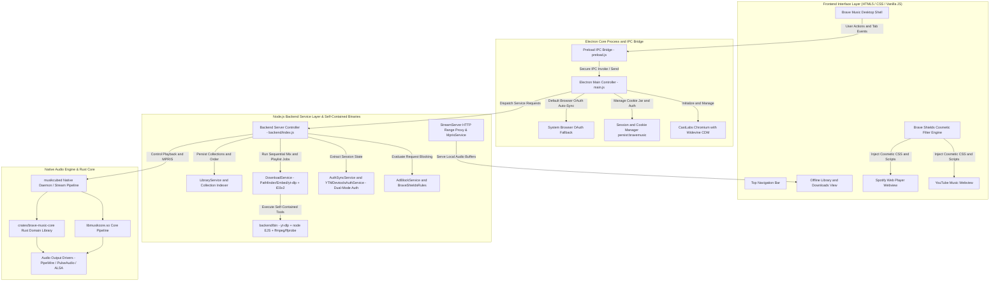

# Developer Guide: Brave Music Architecture and Setup

This document provides technical instructions for setting up the local development environment, understanding the application architecture, and building production distribution packages.

---

## 1. System Requirements

Ensure your development environment meets the following specifications:

- **Operating System**: Linux (Ubuntu 22.04+, Debian 12+, Fedora 38+, Arch Linux)
- **Node.js**: v18.x, v20.x, or v22.x
- **Package Manager**: npm v9+
- **Bundled Self-Contained Media Binaries (`backend/bin/`)**:
  - `backend/bin/yt-dlp` (with embedded `yt_dlp_ejs` JS challenge solver)
  - `backend/bin/node` (`ELECTRON_RUN_AS_NODE=1` shim for sandboxed JS solving)
  - `backend/bin/ffmpeg`, `backend/bin/ffprobe`, and bundled `libav*.so` / `libsw*.so`
- **Packaging & Optional Cross-Platform Stack**:
  - `dpkg-deb` / `snapcraft` for `.deb` & Ubuntu Snap packaging
  - `cargo`, `rustc`, `libwebkit2gtk-4.1-dev`, `libgtk-3-dev` for `tauri-preview` + `crates/brave-music-core`

Install system build prerequisites on Ubuntu/Debian (no system `yt-dlp` needed):
```bash
sudo apt update
sudo apt install -y nodejs npm curl dpkg
```

---

## 2. Architecture Overview and Project Specifications

Brave Music organizes its runtime into four synchronized tiers: the Electron desktop shell, the preload IPC security bridge, the backend service controllers, and the embedded native C++ audio engine.

### Project Architecture Diagram



<details>
<summary><strong>Click to View Raw Architecture Diagram Source Code</strong></summary>

```text
graph TD
    subgraph UI ["Frontend Interface Layer (HTML5 / CSS / Vanilla JS)"]
        A[Brave Music Desktop Shell]
        A1[Top Navigation Bar]
        A2[YouTube Music Webview]
        A3[Spotify Web Player Webview]
        A4[Offline Library and Downloads View]
        A5[Brave Shields Cosmetic Filter Engine]
    end

    subgraph IPC ["Electron Core Process and IPC Bridge"]
        B[Electron Main Controller - main.js]
        B1[Preload IPC Bridge - preload.js]
        B2[CastLabs Chromium with Widevine CDM]
        B3[Session and Cookie Manager persist:bravemusic]
        B4[System Browser OAuth Fallback]
    end

    subgraph Backend ["Node.js Backend Service Layer & Self-Contained Binaries"]
        C[Backend Server Controller - backend/index.js]
        C1[AdBlockService and BraveShieldsRules]
        C2[AuthSyncService and YTMDevtoolsAuthService - Dual-Mode Auth]
        C3[DownloadService - Pathfinder/Embed/yt-dlp + ID3v2]
        C4[LibraryService and Collection Indexer]
        C5[StreamServer HTTP Range Proxy & MprisService]
        C6[backend/bin - yt-dlp + node EJS + ffmpeg/ffprobe]
    end

    subgraph Engine ["Native Audio Engine & Rust Core"]
        D[musikcubed Native Daemon / Stream Pipeline]
        D1[libmusikcore.so Core Pipeline]
        D2[crates/brave-music-core Rust Domain Library]
        D3[Audio Output Drivers - PipeWire / PulseAudio / ALSA]
    end

    A --> B1
    B1 --> B
    B --> B2
    B --> B3
    B --> B4
    B --> C
    A5 --> A2
    A5 --> A3
    C --> C1
    C --> C2
    C --> C3
    C3 --> C6
    C --> C4
    C --> D
    C5 --> A4
    D --> D1
    D --> D2
    D1 --> D3
    D2 --> D3
```
</details>

### Architectural Components

#### 1. Electron Main Process (`main.js`)
- Boots CastLabs Electron runtime with verified Widevine CDM support.
- Configures Chrome User-Agent masquerading and removes `AutomationControlled` flags to prevent bot detection.
- Manages authenticated webviews (`persist:bravemusic` partition) for YouTube Music and Spotify.
- Controls window lifecycle, system tray hooks, and external browser authentication modals.

#### 2. Preload and IPC Bridge (`preload.js`)
- Uses `contextBridge.exposeInMainWorld('electronAPI', ...)` to expose strictly typed, safe methods to the frontend renderer.
- Prevents renderer script access to Node.js internals (`contextIsolation: true`, `nodeIntegration: false`).

#### 3. Backend Services (`backend/`) & Bundled Binaries (`backend/bin/`)
- **ShieldsController & AdBlockService**: Evaluates network URLs against declarative Brave Shields ad and tracker lists.
- **YTMDevtoolsAuthService & AuthSyncService**: Implements **Dual-Mode Authentication**—Brave Music Sign-In modal uses the Default Browser to bypass embedded Google OAuth restrictions and persists cookies into `persist:bravemusic` browser memory (with emergency `.json` import fallback), while Inside-App webview logins persist natively without forcing external browsers.
- **DownloadService & `backend/bin/`**: Uses bundled standalone `yt-dlp`, `node` EJS challenge solver (`ELECTRON_RUN_AS_NODE=1`), and `ffmpeg`/`ffprobe` to resolve Spotify Playlists, Personalized Mixes, Albums, and Artists via **Pathfinder GraphQL (paginated) + Embed `__NEXT_DATA__`**, plus YouTube/YouTube Music Playlists & Radio Mixes (`RD...`) via `--flat-playlist` in exact `1..N` provider sequence with 320kbps MP3 extraction and ID3v2 tagging.
- **LibraryService, StreamServer, & MprisService**: Persists `library.json`, guarantees `syncPlaylistSequence` `1..N` ordering, serves local Range audio, and syncs desktop `org.mpris.MediaPlayer2.bravemusic` media controls.

#### 4. Native Engine (`backend/engine/musikcube/`)
- Contains precompiled shared objects (`libmusikcore.so`, `libtag.so.2`, `libavcodec-musikcube.so.62`) and daemon binary `musikcubed`.
- Provides lightweight local indexing, tag extraction, and audio output via ALSA, PulseAudio, or PipeWire.

---

## 3. Local Installation and Setup

### Clone Repository
```bash
git clone git@github.com:codemolabs/Brave-Music.git
cd Brave-Music
```

### Install NPM Dependencies
The project uses CastLabs Electron releases for Widevine DRM capabilities:
```bash
npm install
```

### Run Application in Development Mode
```bash
npm start
```
Alternatively, execute the launch script directly:
```bash
./run.sh
```

---

## 4. CastLabs Widevine Verification

To verify that CastLabs Electron is correctly configured and detects the Widevine CDM runtime on your machine:

```bash
node test-widevine-ready.js
```
Expected output:
```
App ready, waiting for widevine-ready or widevine-error...
>>> CastLabs Widevine is ready! Version: 4.10.2830.0
```

To test EME audio playback support:
```bash
node test-castlabs-eme.js
```

---

## 5. Building Distribution Packages (Linux)

Brave Music supports automated build scripts for official Ubuntu Snap and Linux Debian packaging:

### Building Official Ubuntu Snap Package (`.snap`)
```bash
npm run build:snap
```
Or run the script directly:
```bash
bash Install/Linux/build-snap.sh
```
The script validates the Snapcraft skeleton (`snap/snapcraft.yaml`) and builds the package at `Install/Linux/brave-music_1.0.19-r_amd64.snap`.

### Building Linux Debian Package (`.deb`)
```bash
npm run build:deb
```
Or run the script directly:
```bash
bash Install/Linux/build-deb.sh
```
The script builds the package at `Install/Linux/brave-music_1.0.19-r_amd64.deb`.

---

## 6. Modern Cross-Platform Stack (Rust + Native Webview Core)

Beginning with release `v1.0.19-r`, Brave Music features a modern, ultra-lightweight cross-platform architecture built on Rust and OS-native webviews (WebKitGTK on Linux, WebView2 on Windows, WebKit on macOS, Android System WebView). This stack eliminates Electron runtime overhead and achieves instantaneous startup, smooth 60fps scrolling, and minimal memory usage.

### Directory Structure

```text
├── crates/
│   └── brave-music-core/          # Pure Rust business logic (metadata, storage, library DB)
├── tauri-preview/
│   ├── src-tauri/                 # Rust desktop host application
│   │   ├── src/main.rs            # Host lifecycle, native GTK overlay, audio server
│   │   └── Cargo.toml             # Rust dependencies (tauri v2, tokio, gtk)
│   └── ui/                        # High-performance Vanilla frontend assets
│       ├── index.html             # OneUI-inspired responsive layout
│       ├── styles/main.css        # Hardware-accelerated dark theme styles
│       └── js/app.js              # State manager and IPC bridging
```

### Building and Running the Native Stack

#### System Prerequisites (Ubuntu / Debian)
```bash
sudo apt update
sudo apt install -y cargo rustc libwebkit2gtk-4.1-dev libgtk-3-dev
```

#### Launching the Native Preview
Run with the `--new-stack` flag:
```bash
./run.sh --new-stack
# Shortcuts: ./run.sh -n  or  ./run.sh --preview  or  ./run.sh --rust
```

#### Compiling Production Release Binary
```bash
cargo build --release --manifest-path tauri-preview/src-tauri/Cargo.toml
cp tauri-preview/src-tauri/target/release/brave-music-linux-preview ~/.cargo/bin/brave-music-linux-preview
```

### Key Technical Features

1. **Independent HTTP Range Audio Engine**:
   - Built-in multi-threaded HTTP server (`handle_stream_client`) handling `Range: bytes=` requests with `206 Partial Content`.
   - Instant seeking across local MP3, M4A, and FLAC audio files with zero playback delay.
2. **Hardware-Accelerated Compositing & Native Scrolling**:
   - Configures WebKitGTK with `WEBKIT_FORCE_COMPOSITING_MODE=1` and pure GPU translation curves (`translateY(14px) translateZ(0)`).
   - Eliminates expensive `backdrop-filter` readbacks, maintaining locked 60fps during library scrolling.
3. **Throttled Shields Ad-Filtering**:
   - `scheduleScan()` debounces DOM inspection to 350ms, allowing smooth infinite scroll in YouTube Music and Spotify without main-thread starvation.

---

## 7. Common Troubleshooting

### Issue: Spotify Web player reports "Protected Content Not Enabled"
- **Cause**: Missing or uninitialized Widevine CDM.
- **Solution**: Ensure CastLabs Electron is installed from the repository package.json dependencies. Run `node test-widevine-ready.js` to trigger automatic CDM provisioning into your user data directory.

### Issue: Offline download fails
- **Cause**: Outdated player client configuration, unavailable/private personalized mix without sign-in, or network timeout.
- **Solution**: Brave Music ships its own self-contained `yt-dlp`, `node` EJS runtime, and `ffmpeg` under `backend/bin/` (`appConfig.resolveYtDlpBinary()`). Verify bundled binaries execute cleanly (`./backend/bin/yt-dlp --version`), and ensure you are signed in to Spotify inside Brave Music for personalized mixes (`Daily Mix`, `Blend`, `Daylist`).

### Issue: No audio output from local engine
- **Cause**: Audio daemon lacks active output sink.
- **Solution**: Verify PipeWire or PulseAudio is running:
  ```bash
  systemctl --user status pipewire pulse
  ```

---

## 8. Release Management and Documentation Hub

- **Installation and System Deployment**: Detailed distribution instructions for users and system administrators are documented in [INSTALL.md](INSTALL.md).
- **Release Tracking and Changelogs**: Version tags, SHA-256 checksums, and update notes are maintained in [RELEASE.md](RELEASE.md).
- **UI/UX Design Standards**: Refer to [DESIGN-GUIDE.md](DESIGN-GUIDE.md) for styling and component guidelines.
- **Security Policy**: Refer to [SECURITY.md](SECURITY.md) for disclosure guidelines and isolation rules.
- **Project Governance**: Refer to [RULES.md](RULES.md) for ownership and contributor conduct.

