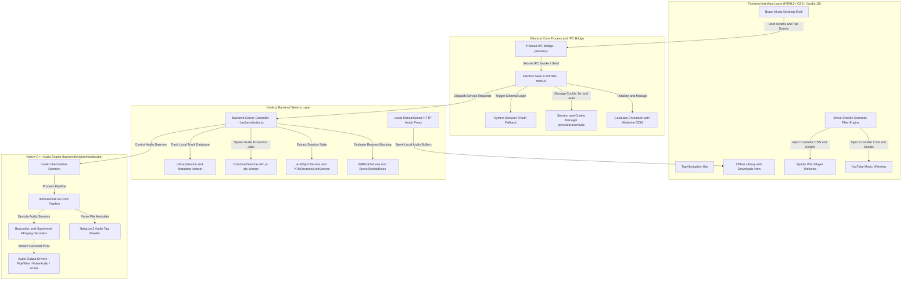

# Developer Guide: Brave Music Architecture and Setup

This document provides technical instructions for setting up the local development environment, understanding the application architecture, and building production distribution packages.

---

## 1. System Requirements

Ensure your development environment meets the following specifications:

- **Operating System**: Linux (Ubuntu 22.04+, Debian 12+, Fedora 38+, Arch Linux)
- **Node.js**: v18.x or v20.x
- **Package Manager**: npm v9+
- **System Binaries**:
  - `yt-dlp` (required for offline media extraction)
  - `curl` (used for audio fetching and health checks)
  - `dpkg-deb` (required for Debian package builds)

Install system dependencies on Ubuntu/Debian:
```bash
sudo apt update
sudo apt install -y nodejs npm yt-dlp curl dpkg
```

---

## 2. Architecture Overview and Project Specifications

Brave Music organizes its runtime into four synchronized tiers: the Electron desktop shell, the preload IPC security bridge, the backend service controllers, and the embedded native C++ audio engine.

### Project Architecture Diagram



<details>
<summary><strong>Click to View Raw Architecture Diagram Source Code</strong></summary>

```text
graph TD
    subgraph UI ["Frontend Interface Layer (HTML5 / CSS / Vanilla JS)"]
        A[Brave Music Desktop Shell]
        A1[Top Navigation Bar]
        A2[YouTube Music Webview]
        A3[Spotify Web Player Webview]
        A4[Offline Library and Downloads View]
        A5[Brave Shields Cosmetic Filter Engine]
    end

    subgraph IPC ["Electron Core Process and IPC Bridge"]
        B[Electron Main Controller - main.js]
        B1[Preload IPC Bridge - preload.js]
        B2[CastLabs Chromium with Widevine CDM]
        B3[Session and Cookie Manager persist:bravemusic]
        B4[System Browser OAuth Fallback]
    end

    subgraph Backend ["Node.js Backend Service Layer"]
        C[Backend Server Controller - backend/index.js]
        C1[AdBlockService and BraveShieldsRules]
        C2[AuthSyncService and YTMDevtoolsAuthService]
        C3[DownloadService with yt-dlp Worker]
        C4[LibraryService and Metadata Indexer]
        C5[Local StreamServer HTTP Audio Proxy]
    end

    subgraph Engine ["Native C++ Audio Engine (backend/engine/musikcube)"]
        D[musikcubed Native Daemon]
        D1[libmusikcore.so Core Pipeline]
        D2[libtag.so.2 Audio Tag Reader]
        D3[libavcodec and libavformat FFmpeg Decoders]
        D4[Audio Output Drivers - PipeWire / PulseAudio / ALSA]
    end

    A --> B1
    B1 --> B
    B --> B2
    B --> B3
    B --> B4
    B --> C
    A5 --> A2
    A5 --> A3
    C --> C1
    C --> C2
    C --> C3
    C --> C4
    C --> D
    C5 --> A4
    D --> D1
    D1 --> D2
    D1 --> D3
    D3 --> D4
```
</details>

### Architectural Components

#### 1. Electron Main Process (`main.js`)
- Boots CastLabs Electron runtime with verified Widevine CDM support.
- Configures Chrome User-Agent masquerading and removes `AutomationControlled` flags to prevent bot detection.
- Manages authenticated webviews (`persist:bravemusic` partition) for YouTube Music and Spotify.
- Controls window lifecycle, system tray hooks, and external browser authentication modals.

#### 2. Preload and IPC Bridge (`preload.js`)
- Uses `contextBridge.exposeInMainWorld('electronAPI', ...)` to expose strictly typed, safe methods to the frontend renderer.
- Prevents renderer script access to Node.js internals (`contextIsolation: true`, `nodeIntegration: false`).

#### 3. Backend Services (`backend/`)
- **ShieldsController & AdBlockService**: Evaluates network URLs against declarative Brave Shields ad and tracker lists.
- **YTMDevtoolsAuthService & AuthSyncService**: Manages session cookies and headers for music services.
- **DownloadService**: Coordinates `yt-dlp` audio-only stream extraction, YouTube and Spotify playlist metadata extraction, ordered track indexing, and reactive library synchronization.
- **MusikcubeService & StreamServer**: Manages `musikcubed` lifecycle and local HTTP audio streams.

#### 4. Native Engine (`backend/engine/musikcube/`)
- Contains precompiled shared objects (`libmusikcore.so`, `libtag.so.2`, `libavcodec-musikcube.so.62`) and daemon binary `musikcubed`.
- Provides lightweight local indexing, tag extraction, and audio output via ALSA, PulseAudio, or PipeWire.

---

## 3. Local Installation and Setup

### Clone Repository
```bash
git clone git@github.com:codemoteams/Brave-Music.git
cd Brave-Music
```

### Install NPM Dependencies
The project uses CastLabs Electron releases for Widevine DRM capabilities:
```bash
npm install
```

### Run Application in Development Mode
```bash
npm start
```
Alternatively, execute the launch script directly:
```bash
./run.sh
```

---

## 4. CastLabs Widevine Verification

To verify that CastLabs Electron is correctly configured and detects the Widevine CDM runtime on your machine:

```bash
node test-widevine-ready.js
```
Expected output:
```
App ready, waiting for widevine-ready or widevine-error...
>>> CastLabs Widevine is ready! Version: 4.10.2830.0
```

To test EME audio playback support:
```bash
node test-castlabs-eme.js
```

---

## 5. Building Distribution Packages (Linux & Windows)

Brave Music supports automated build scripts for both Linux Debian and Windows 10/11:

### Building Linux Debian Package (`.deb`)
```bash
npm run build:deb
```
Or run the script directly:
```bash
bash Install/Linux/build-deb.sh
```
The script builds the package at `Install/Linux/brave-music_1.0.18_amd64.deb`.

### Building Windows Suite (`.exe` & `.zip`)
```bash
npm run build:win
```
Or run the script directly:
```bash
bash Install/Windows/build-win.sh
```
The script outputs:
- `Install/Windows/BraveMusic-Setup-1.0.18.exe` (Self-extracting GUI suite)
- `Install/Windows/brave-music_1.0.18_win64.zip` (Portable suite)

### Building WinUI 3 Native Installer
Navigate to `Install/Windows/BraveMusic.Installer/` and compile with `winapp CLI`:
```powershell
winget install Microsoft.winappcli --source winget
winapp build
winapp package
```

---

## 6. Common Troubleshooting

### Issue: Spotify Web player reports "Protected Content Not Enabled"
- **Cause**: Missing or uninitialized Widevine CDM.
- **Solution**: Ensure CastLabs Electron is installed from the repository package.json dependencies. Run `node test-widevine-ready.js` to trigger automatic CDM provisioning into your user data directory.

### Issue: Offline download fails
- **Cause**: Outdated `yt-dlp` binary.
- **Solution**: Update `yt-dlp` to the latest release using `sudo yt-dlp -U` or install the latest binary from GitHub releases.

### Issue: No audio output from local engine
- **Cause**: Audio daemon lacks active output sink.
- **Solution**: Verify PipeWire or PulseAudio is running:
  ```bash
  systemctl --user status pipewire pulse
  ```

---

## 7. Release Management and Documentation Hub

- **Installation and System Deployment**: Detailed distribution instructions for users and system administrators are documented in [INSTALL.md](INSTALL.md).
- **Release Tracking and Changelogs**: Version tags, SHA-256 checksums, and update notes are maintained in [RELEASE.md](RELEASE.md).
- **UI/UX Design Standards**: Refer to [DESIGN-GUIDE.md](DESIGN-GUIDE.md) for styling and component guidelines.
- **Security Policy**: Refer to [SECURITY.md](SECURITY.md) for disclosure guidelines and isolation rules.
- **Project Governance**: Refer to [RULES.md](RULES.md) for ownership and contributor conduct.

